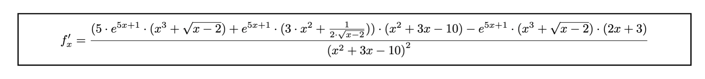
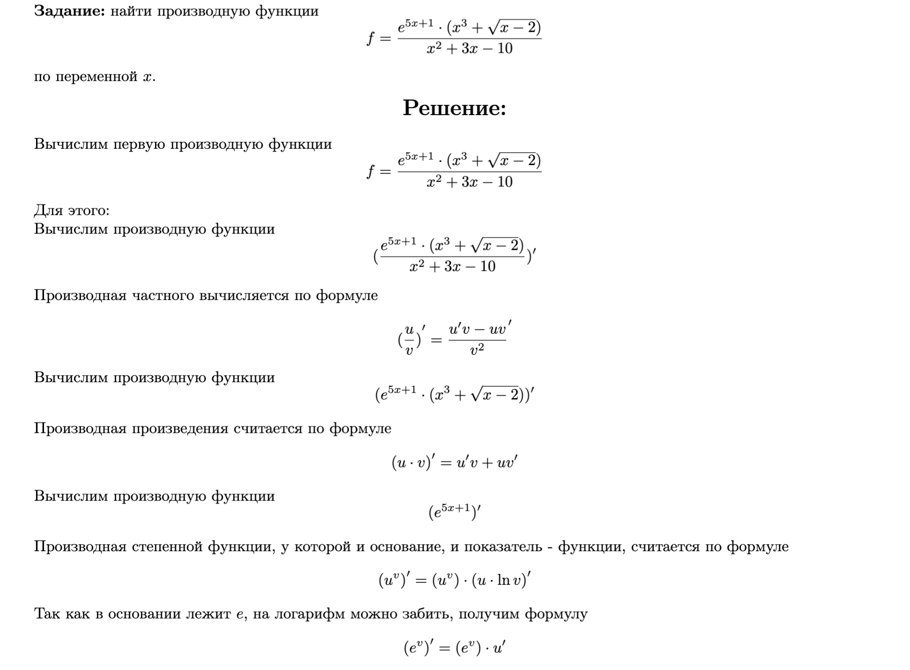
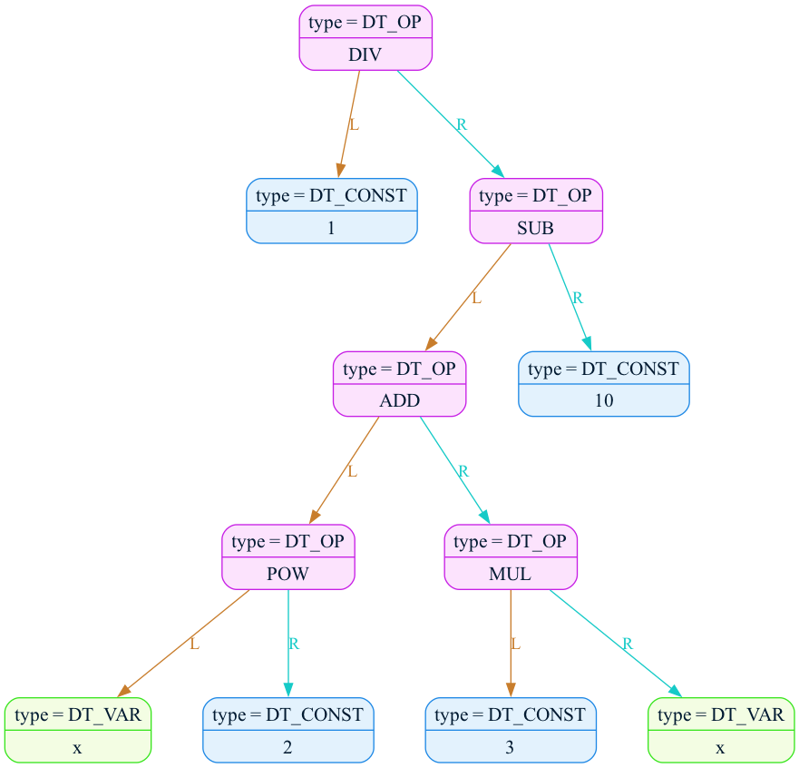
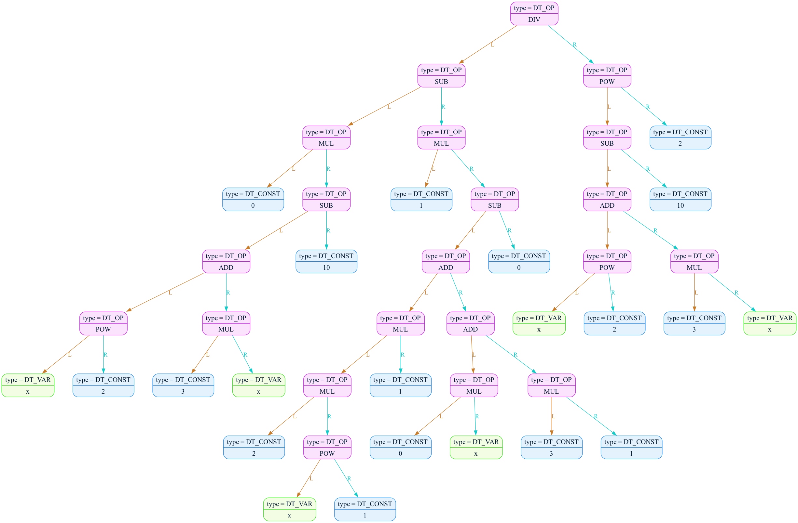
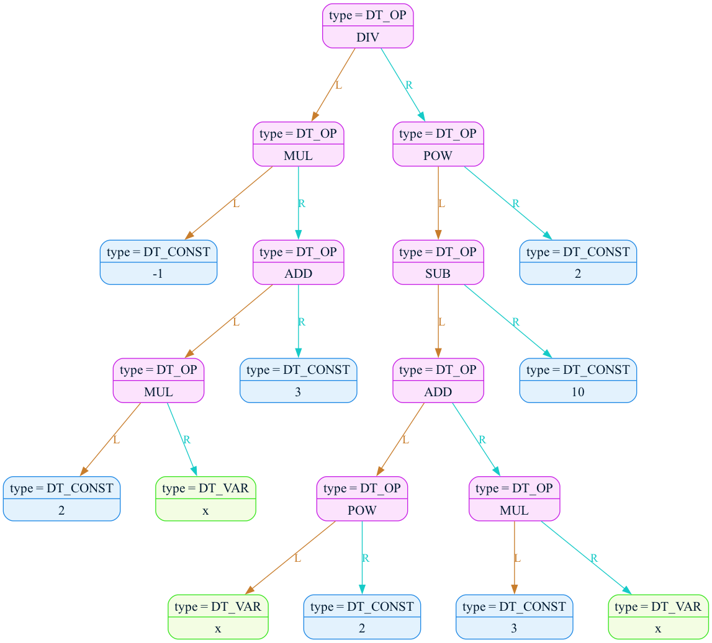

# Дифференциатор 

> Программа-дифференциатор, умеющая находить производные любых порядков любых функций и генерировать супер подробный отчет о том, как это было сделано, в `.tex` и `.pdf` файле

<p align="center">
  <br>
  <em>Пример вывода программы</em>
</p>

## Feature List
- Собственный DSL для описания операций дифференцирования
- Возможность искать производную по любой переменной 
- Возможность поиска производных любых порядков
- Поддержка работы с константами вроде π и e
- Свертка констант
- Генерация подробнейшего .tex и .pdf отчета о том, как были произведены вычисления
- Генерация графического дампа в виде красивого арифмитического дерева в логе

---

## О программе
1. Программа читает из файла (`data.txt` по умолчанию) исходное математическое выражение в префиксной записи
2. По этой записи строится арифметическое дерево выражения
3. Пользователь выбирает режим работы через интерактивное меню:
   - взять первую производную,
   - взять n-ю производную,
   - (в разработке) разложить по Тейлору / Маклорену
4. Программа пошагово дифференцирует дерево, обьясняя каждый шаг — какие правила применялись, какие поддеревья преобразовывались
5. Результат и весь ход решения записываются в `.tex`-файл, после чего вызывается `pdflatex` для сборки `.pdf`.

---

## Формат входных данных
Выражение записывается в виде **префиксной записи** в формате:
```
(оператор1 (переменная0 nil nil) (оператор2 (переменная1 nil nil) (переменная2 nil nil)))
```
Например, запись 
```
(div (mul (pow (e nil nil) (add (mul (5 nil nil) (x nil nil)) (1 nil nil))) (add (pow (x nil nil) (3 nil nil)) (sqrt nil (sub (x nil nil) (2 nil nil))))) (sub (add (pow (x nil nil) (2 nil nil)) (mul (3 nil nil) (x nil nil))) (10 nil nil)))
```
равносильна выражению 
$$
\frac{e^{5x+1} \cdot \left(x^3 + \sqrt{x - 2}\right)}{x^2 + 3x - 10}
$$

---

## Поддерживаемые операции
| Операция | Формат записи | Математический смысл |
|----------|---------------|----------------------|
| `ADD` | `(add A B)` | `A + B` |
| `SUB` | `(sub A B)` | `A − B` |
| `MUL` | `(mul A B)` | `A · B` |
| `DIV` | `(div A B)` | `A / B` |
| `POW` | `(pow A B)` | `A^B` |
| `ROOT` | `(root A B)` | корень `A`-й степени из `B` |
| `SQRT` | `(sqrt nil A)` | `√A` |
| `LN` | `(ln nil A)` | `ln(A)` |
| `SIN` | `(sin nil A)` | `sin(A)` |
| `COS` | `(cos nil A)` | `cos(A)` |
| `TG` | `(tg nil A)` | `tg(A)` |
| `CTG` | `(ctg nil A)` | `ctg(A)` |
| `ARCSIN` | `(arcsin nil A)` | `arcsin(A)` |
| `ARCCOS` | `(arccos nil A)` | `arccos(A)` |
| `ARCTG` | `(arctg nil A)` | `arctg(A)` |
| `ARCCTG` | `(arcctg nil A)` | `arcctg(A)` |
| `SH` | `(sh nil A)` | `sh(A)` |
| `CH` | `(ch nil A)` | `ch(A)` |
| `TH` | `(th nil A)` | `th(A)` |
| `CTH` | `(cth nil A)` | `cth(A)` |


---

## Пример выходного файла
<p align="center">
  <a href="assets/example.pdf">
    
  </a>
  <br>
  <a href="assets/example.pdf"><em>Картинка кликабельна (подпись тоже)</em></a>
</p>

---

## Графический дамп арифмитического дерева
<p align="center">
  <br>
  <em>Пример арифмитического дерева функции</em>
</p>
<p align="center">
  <br>
  <em>Арифмитическое дерево ее производной до свертки констант</em>
</p>
<p align="center">
  <br>
  <em>Итоговое арифмитическое дерево ее производной</em>
</p>

---

## Требования для запуска
Платформа: macos

Должен быть установлен компилятор clang++, а также LaTex (его утилита pdflatex для генерации `pdf`-файлов из `.tex` файлов)

---

## Запуск
Полная сборка: клонирование, компиляция и запуск
```
git clone https://github.com/mathusha2023/differentiator
cd differentiator
chmod +x ./build.sh
./build.sh
cp ./assets/example-data.txt ./data.txt
./diff
```

После сборки достаточно просто менять data.txt файл и запускать программу командой 
```
./diff
```

---

## Изменение конфига
Вы можете изменить входной и выходной файлы программы, заданные по умолчанию, изменив `config.h` файл программы - константы
```
const char DATA_FILE_NAME[] = "data.txt";
const char TEX_FILE_NAME[] = "output.tex";
```
можно поменять на свои

---

## DSL 
Для более удобного взаимодействия с математическим аппаратом программы был сделан свой камерный DSL. Подробнее с ним можно ознакомиться в файле [dsl.h](dsl.h)

---

## Связь со мной
Я всегда рад отзывам, предложениям, общению и денюжке. Свяжитесь со мной, если хотите предложить мне один из этих пунктов: [ква](https://t.me/mathusha2023)
